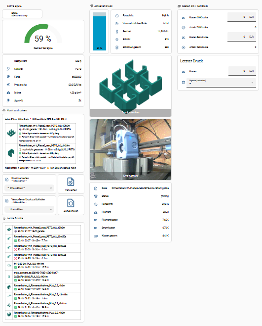
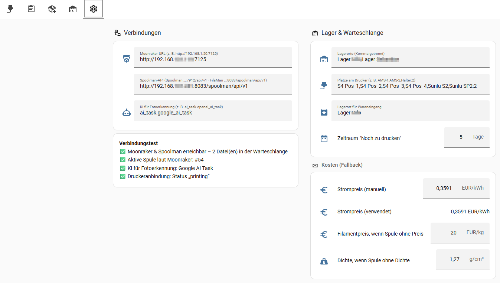
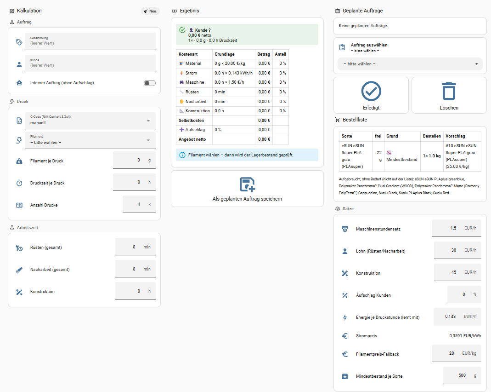
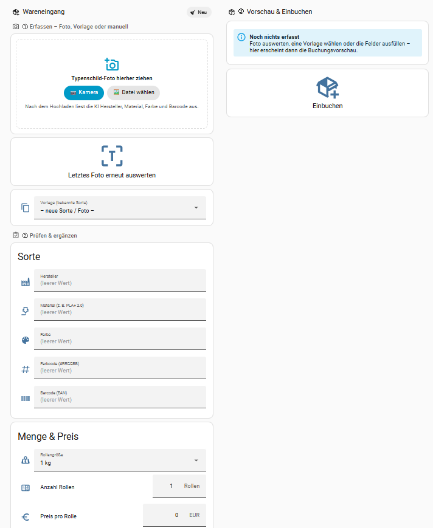
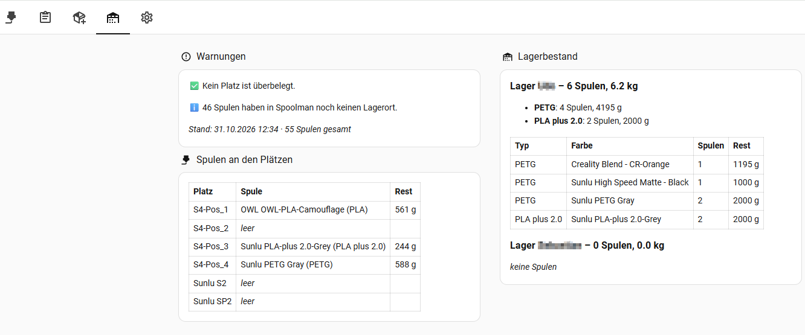

# 3D Print Manager for Home Assistant

[🇩🇪 Deutsche Version](README.md)


Print management, filament inventory and job costing for **Klipper printers with Moonraker and Spoolman or [FilaMan](https://www.filaman.app)** – entirely inside Home Assistant, as one package plus a dashboard.

> ⚠️ **Beta:** Developed and tested with a **Sovol SV08** (Klipper, Moonraker, **FilaMan** via its Spoolman-compatible API, OrcaSlicer). Original Spoolman uses the same API and should work the same way, but has not been tested separately. Other Moonraker printers should work but are untested. Please report results as an [issue](../../issues). OctoPrint/Marlin support is planned.
>
> The user interface (dashboard, notifications) is currently **German only**.

## Screenshots

| Printer | Settings with connection test |
|---|---|
|  |  |
| **Job costing & reorder list** | **Goods receipt with photo upload** |
|  |  |
| **Storage** | |
|  | |

## Features

**Printer**
- Vertical progress bar with estimated finish time, time left, layers
- Live cost of the current print (filament by spool price/density, electricity from a smart plug)
- Cost booking for successful vs. failed prints, re-bookable afterwards
- Last 10 prints with thumbnail
- **Print queue:** all G-codes of the last x days without a successful print, with thumbnail
- **Filament check per file** in print order: is the active spool enough? Otherwise suggests matching spools from printer slots or storage – exact material (PLA ≠ PLA+ ≠ PLA+ 2.0), colour (if set in the slicer), same manufacturer when swapping spools mid-print
- **Notification when a print ends** (done, error, cancelled): push to phones and Alexa announcement within a configurable time window, targets set in the *Einstellungen* tab
- **Discard / restore** G-codes (moved to folder `verworfen` on the printer, nothing is deleted)

**Jobs**
- Costing from a G-code (weight & time filled in automatically) or manual input
- Cost breakdown: material, electricity (self-learning kWh per print hour), machine, setup, post-processing, design, markup – per customer or internal
- Stock check: inventory − running/queued prints − planned jobs
- Planned jobs with status; reorder list based on minimum stock with the cheapest supplier suggestion

**Goods receipt**
- Book spools into Spoolman/FilaMan: manually, from a template, or **from a photo of the spool label** (AI reads manufacturer, material, colour, weight, barcode)
- Upload card with drag & drop (desktop) or direct camera (mobile)
- Up to 3 matching known filaments are suggested; nothing is adopted until you pick one, and every value stays editable
- New vendors/filaments are only created after explicit confirmation; the barcode is stored and recognised next time
- Retailer (e.g. Amazon, Polymaker, Sunlu – configurable) and an optional lot number are noted on the spool; preferred retailers feed the reorder list suggestion

**Storage**
- Spools at printer slots (with over-occupancy warning) and stock per storage location

## Requirements

| What | Required | Note |
|---|---|---|
| Home Assistant OS / Supervised | ✅ | tested with 2026.10; uses `python3` inside the HA container |
| Klipper + Moonraker | ✅ | Moonraker reachable on the network |
| [Moonraker integration](https://github.com/marcolivierarsenault/moonraker-home-assistant) (HACS) | ✅ | provides the printer sensors |
| [Spoolman](https://github.com/Donkie/Spoolman) **or** [FilaMan](https://www.filaman.app) (Spoolman-compatible API), connected to Moonraker | ✅ | inventory, active spool, prices |
| [Bar Card](https://github.com/custom-cards/bar-card) (HACS) | optional | vertical progress bar |
| Smart plug with energy meter | optional | real electricity cost, otherwise estimated |
| AI integration with **AI Task** (e.g. OpenAI, Google, Anthropic) | optional | spool label recognition |
| Slicer: OrcaSlicer / PrusaSlicer / SuperSlicer | recommended | material/colour are read from the G-code |

## Installation

1. **Enable packages** (if not done yet) in `configuration.yaml`:
   ```yaml
   homeassistant:
     packages: !include_dir_named packages
   ```
2. **Copy files** (e.g. with the *File editor* or *Samba* app):
   - `packages/3d_print_manager.yaml` → `/config/packages/3d_print_manager.yaml`
   - `www/print_manager/pm-foto-upload-card.js` → `/config/www/print_manager/pm-foto-upload-card.js`
3. **Adapt the printer binding:** in `3d_print_manager.yaml`, section **1. DRUCKERANBINDUNG**, replace the prefix `sovol_sv08` with the prefix of your Moonraker entities (e.g. `sensor.my_printer_progress` → `my_printer`). Optionally add your energy meter and electricity price sensor.
4. **Restart Home Assistant**.
5. **Register the card:** *Settings → Dashboards → ⋮ → Resources → Add resource*
   URL `/local/print_manager/pm-foto-upload-card.js?v=0.1.0`, type *JavaScript module*.
6. **Create the dashboard:** *Settings → Dashboards → Add dashboard → New dashboard from scratch* → open → ✏️ → ⋮ → *Raw configuration editor* → paste `dashboards/3d_print_manager.yaml` → save. Adjust the two camera entities or delete those cards.
7. **Enter settings** (tab *Einstellungen*): Moonraker URL (`http://192.168.1.50:7125`), Spoolman API (`http://192.168.1.60:7912/api/v1`, or `http://192.168.1.60:8083/spoolman/api/v1` for FilaMan), preferred retailers (comma separated, default Amazon,Polymaker,Sunlu), storage locations (as in Spoolman "Location", comma separated), printer slots (`AMS-1,AMS-2,Holder:2` – `:2` = room for 2 spools), location for goods receipt, AI entity (`ai_task.openai_ai_task`), notification targets for print end (`notify` entities of your phones with the Companion app, e.g. `notify.my_phone` – tapping the notification opens the dashboard, and of Alexa announcements, e.g. `notify.echo_living_room_sprechen` – use the "Sprechen" (speak) entities; the "Durchsagen" (announce) ones stayed silent in testing; comma separated; Alexa window defaults to 8–22 h). Rates are in the *Aufträge* tab.
8. The **connection test** in the *Einstellungen* tab shows within ~5 minutes whether everything is reachable.

> 📷 Photos are stored in *Media → My media → filament_fotos*. Only **administrators** may upload media in Home Assistant.

## Updating

Replace `3d_print_manager.yaml` (keep **your section 1**), copy the new card and bump `?v=…` in the resource URL, re-paste the dashboard if needed, restart. Settings, counters and jobs (`/config/print_manager/`) are kept. See [CHANGELOG.md](CHANGELOG.md).

## Known limitations (beta)

- **Moonraker** (Klipper) only; OctoPrint/Marlin will follow.
- Colour check only when a filament colour is set in the slicer (OrcaSlicer default teal `#26A69A` is ignored).
- The material is taken from the slicer's **filament profile name**; Spoolman materials should use a matching spelling (`PLA+`, `PLAplus`, `PLA plus` are treated as equal).
- The large attributes of `pm_druckwarteschlange` / `pm_kalkulationsdaten` may trigger a recorder warning (> 16 KB) – harmless; optionally exclude them from the recorder.
- One printer per installation.

## License

[GPL-3.0](LICENSE)
