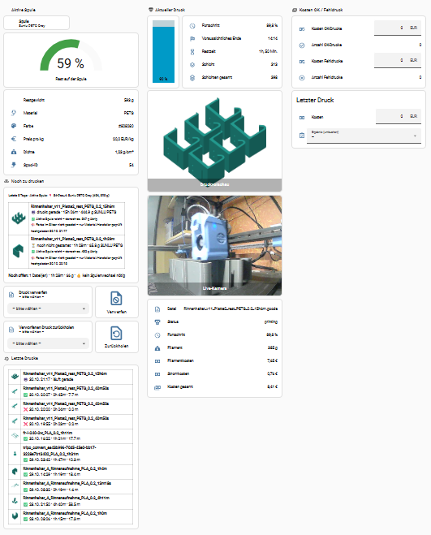
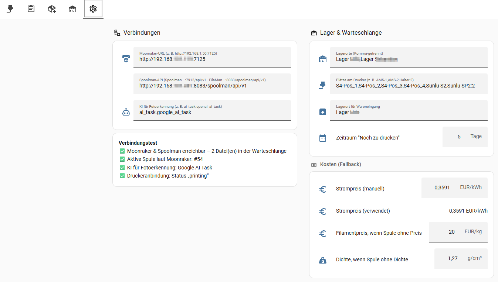
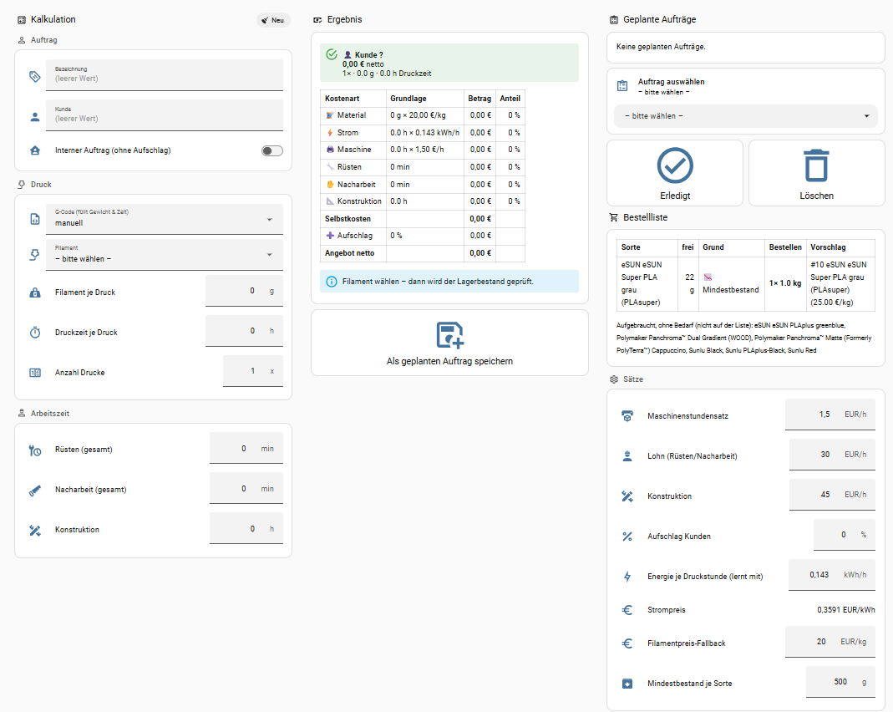
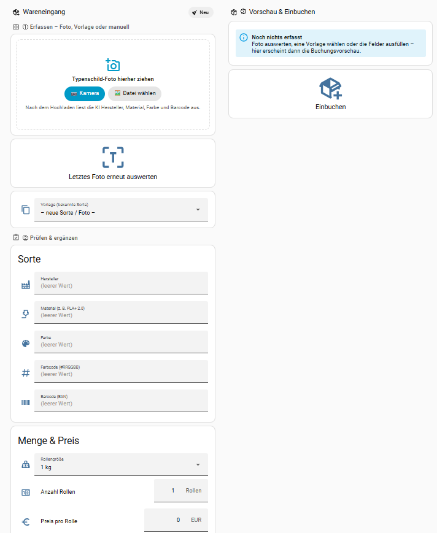
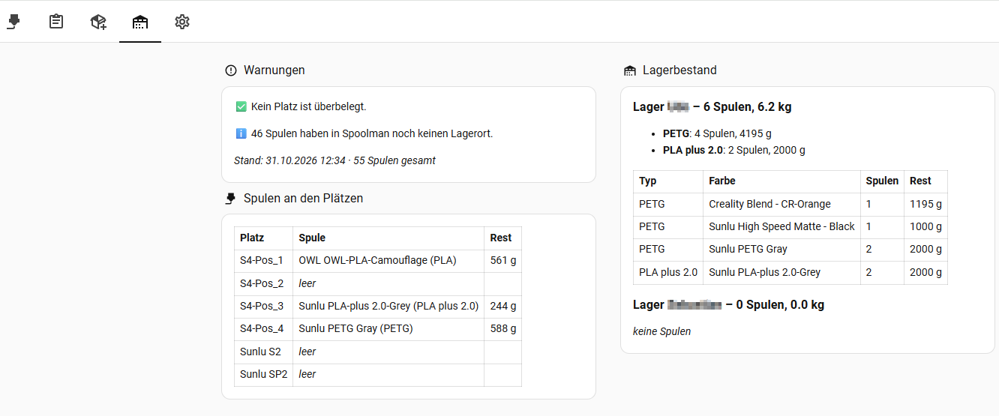

# 3D Print Manager für Home Assistant

[🇬🇧 English version](README.en.md)


Druckverwaltung, Filamentlager und Auftragskalkulation für **Klipper-Drucker mit Moonraker und Spoolman bzw. [FilaMan](https://www.filaman.app)** – komplett in Home Assistant, als ein Package plus Dashboard.

> ⚠️ **Beta:** Entwickelt und getestet mit einem **Sovol SV08** (Klipper, Moonraker, **FilaMan** über die Spoolman-kompatible API, OrcaSlicer). Das originale Spoolman nutzt dieselbe API und sollte genauso funktionieren, ist aber nicht separat getestet. Andere Moonraker-Drucker sollten funktionieren, sind aber nicht getestet. Rückmeldungen bitte als [Issue](../../issues). OctoPrint/Marlin ist geplant.

## Screenshots

| Drucker | Einstellungen mit Verbindungstest |
|---|---|
|  |  |
| **Auftragskalkulation & Bestellliste** | **Wareneingang mit Foto-Upload** |
|  |  |
| **Lager** | |
|  | |

## Funktionen

**Drucker**
- Senkrechter Fortschrittsbalken mit voraussichtlicher Endzeit, Restzeit, Schichten
- Laufende Kosten des aktuellen Drucks (Filament nach Spulenpreis/-dichte, Strom nach Steckdose)
- Kostenbuchung OK-Druck / Fehldruck mit nachträglichem Umbuchen
- Letzte 10 Drucke mit Vorschaubild
- **Noch zu drucken:** alle G-Codes der letzten x Tage ohne erfolgreichen Druck, mit Vorschaubild
- **Filamentprüfung je Datei** in Druckreihenfolge: reicht die aktive Spule? Sonst passende Spulen aus Druckerplätzen oder Lager vorschlagen – exaktes Material (PLA ≠ PLA+ ≠ PLA+ 2.0), Farbe (sofern im Slicer gesetzt), bei Rollenwechsel im Druck nur gleicher Hersteller
- G-Codes **verwerfen / zurückholen** (Ordner `verworfen` auf dem Drucker, nichts wird gelöscht)
- **Meldung bei Druckende** (fertig, Fehler, abgebrochen): Push aufs Handy und Alexa-Durchsage im einstellbaren Zeitfenster, Ziele im Reiter *Einstellungen*

**Aufträge**
- Kalkulation aus G-Code (Gewicht & Zeit automatisch) oder manuell
- Kostenaufteilung: Material, Strom (lernender Erfahrungswert kWh/Druckstunde), Maschine, Rüsten, Nacharbeit, Konstruktion, Aufschlag – kundenbezogen oder intern
- Lagerprüfung: Bestand − laufende/anstehende Drucke − geplante Aufträge
- Geplante Aufträge mit Status, Bestellliste mit Mindestbestand und günstigstem Lieferanten-Vorschlag

**Wareneingang**
- Rollen in Spoolman/FilaMan einbuchen: manuell, per Vorlage oder **per Foto vom Typenschild** (KI liest Hersteller, Material, Farbe, Gewicht, Barcode)
- Upload-Karte mit Drag & Drop (PC) bzw. direkter Kamera (Handy)
- Passende bekannte Sorten werden vorgeschlagen (bis zu 3); übernommen wird erst nach deiner Auswahl, alles bleibt änderbar
- Neue Hersteller/Sorten werden nur nach ausdrücklicher Bestätigung angelegt; Barcode wird gespeichert und wiedererkannt
- Händler (z. B. Amazon, Polymaker, Sunlu – einstellbar) und optionale Charge werden an der Spule vermerkt; bevorzugte Händler fließen in den Vorschlag der Bestellliste ein

**Lager**
- Spulen an den Druckerplätzen (mit Überbelegungs-Warnung) und Bestand je Lagerort

## Voraussetzungen

| Was | Pflicht | Hinweis |
|---|---|---|
| Home Assistant OS / Supervised | ✅ | getestet mit 2026.10; nutzt `python3` im HA-Container |
| Klipper + Moonraker | ✅ | Moonraker im Netzwerk erreichbar |
| [Moonraker-Integration](https://github.com/marcolivierarsenault/moonraker-home-assistant) (HACS) | ✅ | liefert die Druckersensoren |
| [Spoolman](https://github.com/Donkie/Spoolman) **oder** [FilaMan](https://www.filaman.app) (Spoolman-kompatible API), mit Moonraker verbunden | ✅ | Lager, aktive Spule, Preise |
| [Bar Card](https://github.com/custom-cards/bar-card) (HACS) | optional | senkrechter Fortschrittsbalken |
| Steckdose mit Energiezähler | optional | echte Stromkosten; sonst Schätzung |
| KI-Integration mit **AI Task** (z. B. OpenAI, Google, Anthropic) | optional | Fotoerkennung Typenschild |
| Slicer: OrcaSlicer / PrusaSlicer / SuperSlicer | empfohlen | Material/Farbe werden aus dem G-Code gelesen |

## Installation

1. **Packages aktivieren** (falls noch nicht geschehen) – in `configuration.yaml`:
   ```yaml
   homeassistant:
     packages: !include_dir_named packages
   ```
2. **Dateien kopieren** (z. B. mit dem *File editor* oder *Samba*):
   - `packages/3d_print_manager.yaml` → `/config/packages/3d_print_manager.yaml`
   - `www/print_manager/pm-foto-upload-card.js` → `/config/www/print_manager/pm-foto-upload-card.js`
3. **Druckeranbindung anpassen:** In `3d_print_manager.yaml`, Abschnitt **1. DRUCKERANBINDUNG**, das Präfix `sovol_sv08` durch das Präfix deiner Moonraker-Entitäten ersetzen (z. B. `sensor.mein_drucker_progress` → `mein_drucker`). Optional: Energiezähler und Strompreis-Sensor eintragen.
4. **Home Assistant neu starten** (*Einstellungen → System → Neustart*).
5. **Karte registrieren:** *Einstellungen → Dashboards → ⋮ → Ressourcen → Ressource hinzufügen*
   URL `/local/print_manager/pm-foto-upload-card.js?v=0.1.0`, Typ *JavaScript-Modul*.
6. **Dashboard anlegen:** *Einstellungen → Dashboards → Dashboard hinzufügen → Neues Dashboard von Grund auf* → öffnen → ✏️ → ⋮ → *Raw-Konfigurationseditor* → Inhalt von `dashboards/3d_print_manager.yaml` einfügen → Speichern. Die beiden Kamera-Entitäten anpassen oder Karten löschen.
7. **Einstellungen eintragen** (Reiter *Einstellungen* im Dashboard):
   - Moonraker-URL, z. B. `http://192.168.1.50:7125`
   - Spoolman-API, z. B. `http://192.168.1.60:7912/api/v1` (Spoolman) bzw. `http://192.168.1.60:8083/spoolman/api/v1` (FilaMan)
   - Lagerorte (wie das Feld „Location“ in Spoolman/FilaMan, Komma-getrennt), z. B. `Regal,Keller`
   - Plätze am Drucker, z. B. `AMS-1,AMS-2,Halter:2` (`:2` = Platz für 2 Spulen)
   - Bevorzugte Händler (Komma-getrennt), Lagerort für Wareneingang, KI-Entität (z. B. `ai_task.openai_ai_task`)
   - Meldung bei Druckende: `notify`-Entitäten der Handys mit Companion-App (z. B. `notify.pixel_10_pro_xl`; Antippen der Meldung öffnet das Dashboard) und der Alexa-Durchsagen (z. B. `notify.echo_wohnzimmer_sprechen`, benötigt die Alexa-Integration; „…_sprechen“ liest den Text direkt vor, „…_durchsagen“ braucht freigeschaltete Durchsagen in der Alexa-App und blieb im Test stumm), Zeitfenster für Durchsagen (Standard 8–22 Uhr)
   - Sätze im Reiter *Aufträge* (Maschine, Lohn, Konstruktion, Aufschlag, Mindestbestand)
8. Der **Verbindungstest** im Reiter *Einstellungen* zeigt nach spätestens 5 Minuten, ob alles erreichbar ist.

> 📷 **Fotoerkennung:** Fotos landen in *Medien → Mein Medium → filament_fotos*. Hochladen dürfen in Home Assistant nur **Administratoren**.

## Update

1. Neue `3d_print_manager.yaml` übernehmen – **deinen Abschnitt 1 (Druckeranbindung) vorher sichern** und wieder einsetzen.
2. Neue `pm-foto-upload-card.js` kopieren und in der Ressource die Versionsnummer (`?v=…`) erhöhen.
3. Dashboard-YAML bei Bedarf neu einfügen (eigene Anpassungen vorher sichern).
4. Neustart. Einstellungen, Zähler, Aufträge (`/config/print_manager/`) bleiben erhalten.
Siehe [CHANGELOG.md](CHANGELOG.md).

## Dateien & Daten

| Pfad | Inhalt |
|---|---|
| `/config/packages/3d_print_manager.yaml` | gesamte Logik (Sensoren, Helfer, Skripte, Automationen) |
| `/config/www/print_manager/` | Upload-Karte, Vorschaubilder (`thumbs/`) |
| `/config/print_manager/auftraege.json` | gespeicherte Aufträge |
| `/config/print_manager/kalkulation.json` | Zwischenstand für Kalkulation/Lager (wird neu erzeugt) |
| `/media/filament_fotos/` | hochgeladene Typenschild-Fotos |

Alle Entitäten beginnen mit `pm_` (*print manager*).

## Bekannte Einschränkungen (Beta)

- Nur **Moonraker** (Klipper). OctoPrint/Marlin folgt.
- Farbprüfung nur, wenn im Slicer eine Filamentfarbe gesetzt ist (OrcaSlicer-Standard-Türkis `#26A69A` wird ignoriert).
- Material wird aus dem **Filamentprofil-Namen** des Slicers gelesen (z. B. „SUNLU PLA+ 2.0 @System“ → `PLA+ 2.0`). Die Schreibweise in Spoolman sollte dazu passen (`PLA+`, `PLAplus`, `PLA plus` gelten als gleich).
- Große Attribute der Sensoren `pm_druckwarteschlange` / `pm_kalkulationsdaten` können eine Recorder-Warnung (> 16 KB) auslösen – unkritisch. Optional in `recorder: exclude:` aufnehmen.
- Ein Drucker pro Installation.

## Mitmachen

Fehler, Ideen und Testergebnisse mit anderen Druckern gern als [Issue](../../issues) oder Pull Request.

## Lizenz

[GPL-3.0](LICENSE) – Änderungen und Weitergaben müssen ebenfalls unter GPL-3.0 stehen.
